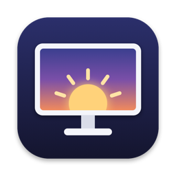

<p align="center">
  
</p>

<h1 align="center">EnoughDisplay</h1>

<p align="center">
  A just-enough macOS menu bar utility for your displays: resolution, disconnect, and hardware brightness in one menu.
</p>

<p align="center">
  macOS 13+ · Universal (Apple Silicon + Intel) · MIT License
</p>

<p align="center">
  <b>English</b> · <a href="#繁體中文">繁體中文</a>
</p>

---

## Features

- **Resolution and refresh rate**: lists every Display Mode macOS offers for each display (including HiDPI) and switches right from the menu.
- **15-second confirmation**: after a mode change, a confirmation panel appears on every screen. If you don't confirm within 15 seconds, the previous mode is restored, so a black screen never leaves you stuck.
- **Disconnect / Reconnect displays**: makes macOS stop rendering to a display entirely, as if you'd unplugged its cable, and moves its windows to the remaining displays. This is not dimming or sleeping the display.
- **Hardware brightness**: built-in panels via DisplayServices, external monitors via DDC/CI, adjusting the actual backlight rather than simulating dimming in software.
- **Mirror aware**: recognizes mirror sets and only offers mode choices on the primary display. It never creates or breaks a mirror set.
- **Launch at login**: a checkbox in the menu.

> The interface is currently in Traditional Chinese. English UI labels are given in parentheses below.

## Installation

1. Download `EnoughDisplay-universal.zip` from [Releases](../../releases), unzip it, and drag `EnoughDisplay.app` into your Applications folder.
2. The app isn't notarized by Apple yet, so Gatekeeper blocks the first launch. Either:
   - run this in Terminal:
     ```sh
     xattr -dr com.apple.quarantine /Applications/EnoughDisplay.app
     ```
   - or try to open it once, then go to **System Settings → Privacy & Security** and click **Open Anyway**.
3. EnoughDisplay lives in the menu bar (a display icon) and doesn't appear in the Dock.

## Usage

Click the display icon in the menu bar. Each display gets its own section:

| Control | What it does |
| --- | --- |
| 解析度 / 更新率 (Resolution / Refresh rate) | Pick a new mode and a confirmation panel appears. Confirm to keep it; otherwise it reverts after 15 seconds. |
| 斷開 (Disconnect) | Stops macOS from rendering to that display. At least one display must stay connected, so the last one can't be disconnected. |
| 重新連接 (Reconnect) | Brings a disconnected display back to the desktop. |
| Brightness slider | Adjusts the hardware backlight. The control method is shown next to it; displays that can't be controlled show 不支援 (Unsupported). |

### Disconnect safety

- **Rebooting or replugging the cable** always brings every display back. Disconnected state is never re-applied automatically.
- **Quitting EnoughDisplay** reconnects every disconnected display first.
- If the app crashes, the next launch offers to reconnect the displays it had disconnected.
- Disconnect may fail while displays are asleep; wake them first.

## Requirements and limitations

- macOS 13 Ventura or later, on Apple Silicon or Intel Macs.
- Disconnect uses a private CoreGraphics API (`CGSConfigureDisplayEnabled`), which means:
  - no Mac App Store and no App Sandbox;
  - a future macOS update may break it;
  - see [ADR 0001](docs/adr/0001-disconnect-via-private-coregraphics-api.md) for the reasoning.
- DDC/CI brightness depends on the monitor supporting it; some monitors, adapters, and docks don't.
- Only Display Modes that macOS itself offers are available; custom resolutions aren't supported.

## Troubleshooting

The app has a built-in diagnostic mode that prints each display's details, available modes, and brightness control:

```sh
/Applications/EnoughDisplay.app/Contents/MacOS/EnoughDisplay --diagnose
```

Add `--ddc` to actually send DDC commands to external monitors and print a step-by-step trace:

```sh
/Applications/EnoughDisplay.app/Contents/MacOS/EnoughDisplay --diagnose --ddc
```

Please include this output when reporting an issue.

## Building from source

Requires Xcode 16 or later.

```sh
git clone https://github.com/ginhogia/EnoughDisplay.git
cd EnoughDisplay

# Debug
xcodebuild -project EnoughDisplay.xcodeproj -scheme EnoughDisplay \
  -configuration Debug -derivedDataPath build build

# Release (Universal: arm64 + x86_64)
xcodebuild -project EnoughDisplay.xcodeproj -scheme EnoughDisplay \
  -configuration Release -derivedDataPath build \
  ARCHS="arm64 x86_64" ONLY_ACTIVE_ARCH=NO build
```

The app is built to `build/Build/Products/<Debug|Release>/EnoughDisplay.app`.

To package a zip for release:

```sh
cd build/Build/Products/Release
ditto -c -k --keepParent EnoughDisplay.app EnoughDisplay-universal.zip
```

The Xcode project is generated by [XcodeGen](https://github.com/yonaskolb/XcodeGen) from `project.yml`; after changing project settings, run `xcodegen generate` to regenerate it.

## Project structure

```
EnoughDisplay/
├── App/               App entry point and state model
├── Displays/          Display enumeration, Display Modes, Disconnect / Reconnect
├── Brightness/        DisplayServices and DDC/CI (Apple Silicon / Intel) brightness
├── ModeConfirmation/  15-second confirmation after a mode change
├── Support/           Private API, launch at login, diagnostics
└── Views/             Menu bar UI
docs/adr/              Architecture decision records
prototypes/            Prototypes used for verification
CONTEXT.md             Domain glossary
```

## License

[MIT](LICENSE)

---

<h2 id="繁體中文">繁體中文</h2>

一個剛剛好的 macOS 選單列顯示器工具：解析度、斷開顯示器、硬體亮度，一個選單搞定。

### 功能

- **切換解析度與更新率**：列出 macOS 為每個顯示器提供的所有顯示模式（含 HiDPI），直接在選單中切換。
- **15 秒確認機制**：切換顯示模式後，每個螢幕都會出現確認視窗；15 秒內沒有確認就自動還原，不怕切到黑畫面回不來。
- **斷開／重新連接顯示器**：讓 macOS 完全停止輸出畫面到某個顯示器，就像拔掉線一樣，視窗會移到其他顯示器上。這不只是把螢幕調暗或讓它睡眠。
- **硬體亮度調整**：內建螢幕透過 DisplayServices 調整，外接螢幕透過 DDC/CI 直接調整背光，不是軟體模擬的變暗。
- **鏡像感知**：辨識鏡像群組，只在主要顯示器上提供模式選擇，不會建立或拆散鏡像設定。
- **開機時啟動**：可在選單中勾選。

### 安裝

1. 到 [Releases](../../releases) 下載 `EnoughDisplay-universal.zip`，解壓後把 `EnoughDisplay.app` 拖進「應用程式」資料夾。
2. App 目前沒有 Apple 公證，第一次開啟會被 Gatekeeper 擋下。擇一處理：
   - 在終端機執行：
     ```sh
     xattr -dr com.apple.quarantine /Applications/EnoughDisplay.app
     ```
   - 或先開啟一次，再到「系統設定 → 隱私權與安全性」按「強制打開」。
3. 開啟後，EnoughDisplay 只會出現在選單列（顯示器圖示），不會出現在 Dock。

### 使用方式

點選單列的顯示器圖示，每個顯示器各有一個區塊：

| 操作 | 說明 |
| --- | --- |
| 解析度／更新率 | 選擇新的模式後會出現確認視窗，按確認才保留，否則 15 秒後還原。 |
| 斷開 | 讓 macOS 停止輸出到該顯示器。至少要保留一個顯示器，所以最後一個不能斷開。 |
| 重新連接 | 讓已斷開的顯示器回到桌面。 |
| 亮度滑桿 | 調整硬體背光。旁邊會標示使用的控制方式；無法控制的顯示器會顯示「不支援」。 |

#### 斷開的安全設計

- **重新開機或重新插拔線材**，所有顯示器一定會回來，斷開狀態不會被自動重新套用。
- **結束 EnoughDisplay** 時會先把所有已斷開的顯示器重新連接。
- 若 app 意外當掉，下次啟動時會提示你重新連接先前斷開的顯示器。
- 顯示器睡眠中時斷開可能會失敗，請先喚醒顯示器。

### 系統需求與限制

- macOS 13 Ventura 以上，Apple Silicon 與 Intel Mac 皆可。
- 「斷開」使用 macOS 的私有 CoreGraphics API（`CGSConfigureDisplayEnabled`），因此：
  - 無法上架 Mac App Store，也不能使用 App Sandbox。
  - 未來的 macOS 更新可能讓這個功能失效。
  - 設計考量詳見 [ADR 0001](docs/adr/0001-disconnect-via-private-coregraphics-api.md)。
- DDC/CI 亮度控制取決於螢幕本身是否支援，部分螢幕、轉接器或 Dock 可能無法使用。
- 只提供 macOS 本身列出的顯示模式，不支援自訂解析度。

### 疑難排解

App 內建診斷模式，會列出每個顯示器的資訊、可用模式與亮度控制方式：

```sh
/Applications/EnoughDisplay.app/Contents/MacOS/EnoughDisplay --diagnose
```

加上 `--ddc` 會實際對外接螢幕發送 DDC 指令，並印出逐步的追蹤紀錄：

```sh
/Applications/EnoughDisplay.app/Contents/MacOS/EnoughDisplay --diagnose --ddc
```

回報問題時附上這段輸出會很有幫助。

### 從原始碼建置

需要 Xcode 16 以上。

```sh
git clone https://github.com/ginhogia/EnoughDisplay.git
cd EnoughDisplay

# Debug
xcodebuild -project EnoughDisplay.xcodeproj -scheme EnoughDisplay \
  -configuration Debug -derivedDataPath build build

# Release（Universal：arm64 + x86_64）
xcodebuild -project EnoughDisplay.xcodeproj -scheme EnoughDisplay \
  -configuration Release -derivedDataPath build \
  ARCHS="arm64 x86_64" ONLY_ACTIVE_ARCH=NO build
```

產出位於 `build/Build/Products/<Debug|Release>/EnoughDisplay.app`。

打包成可發佈的 zip：

```sh
cd build/Build/Products/Release
ditto -c -k --keepParent EnoughDisplay.app EnoughDisplay-universal.zip
```

Xcode 專案由 [XcodeGen](https://github.com/yonaskolb/XcodeGen) 的 `project.yml` 產生；修改專案設定後可執行 `xcodegen generate` 重新產生。

### 專案結構

```
EnoughDisplay/
├── App/               App 進入點與狀態模型
├── Displays/          顯示器列舉、顯示模式、斷開／重新連接
├── Brightness/        DisplayServices 與 DDC/CI（Apple Silicon / Intel）亮度控制
├── ModeConfirmation/  切換顯示模式後的 15 秒確認
├── Support/           私有 API、開機啟動、診斷模式
└── Views/             選單列介面
docs/adr/              架構決策紀錄
prototypes/            驗證用的原型程式
CONTEXT.md             領域用語表
```

### 授權

本專案以 [MIT 授權條款](LICENSE) 釋出。
